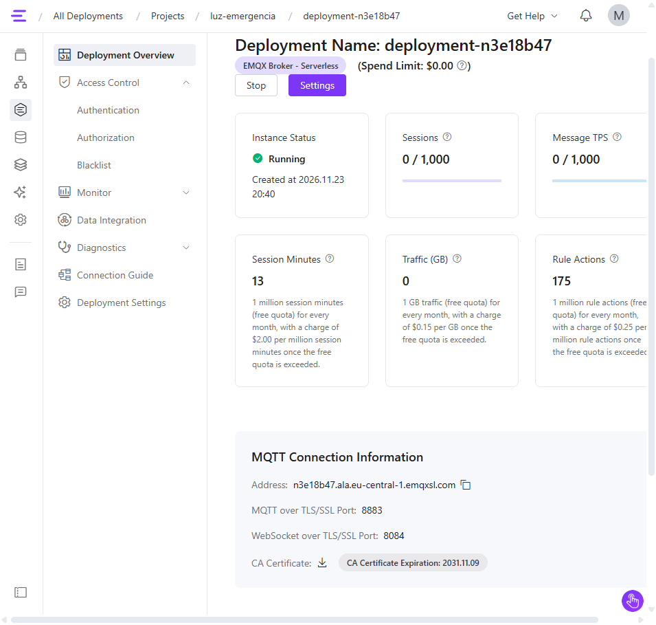
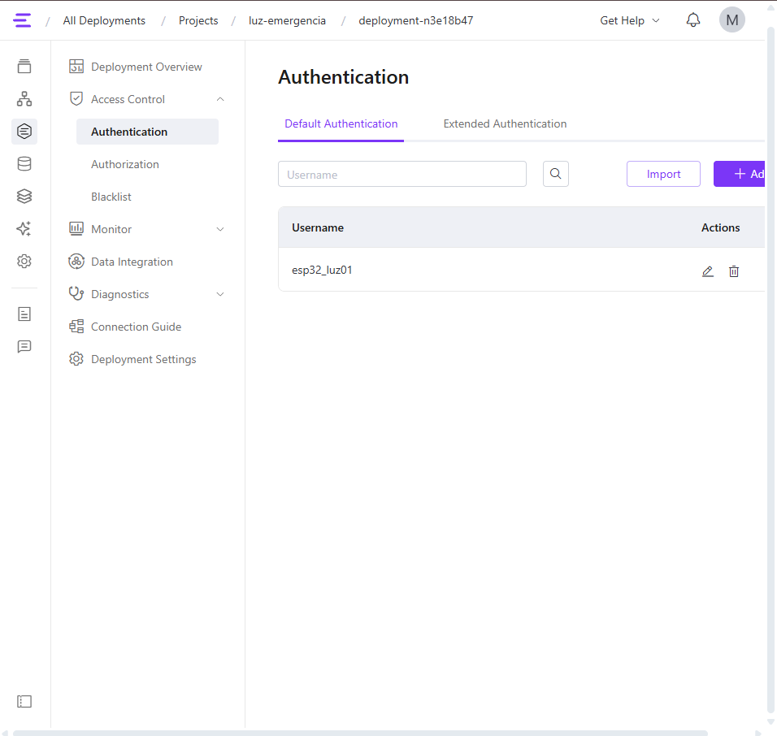
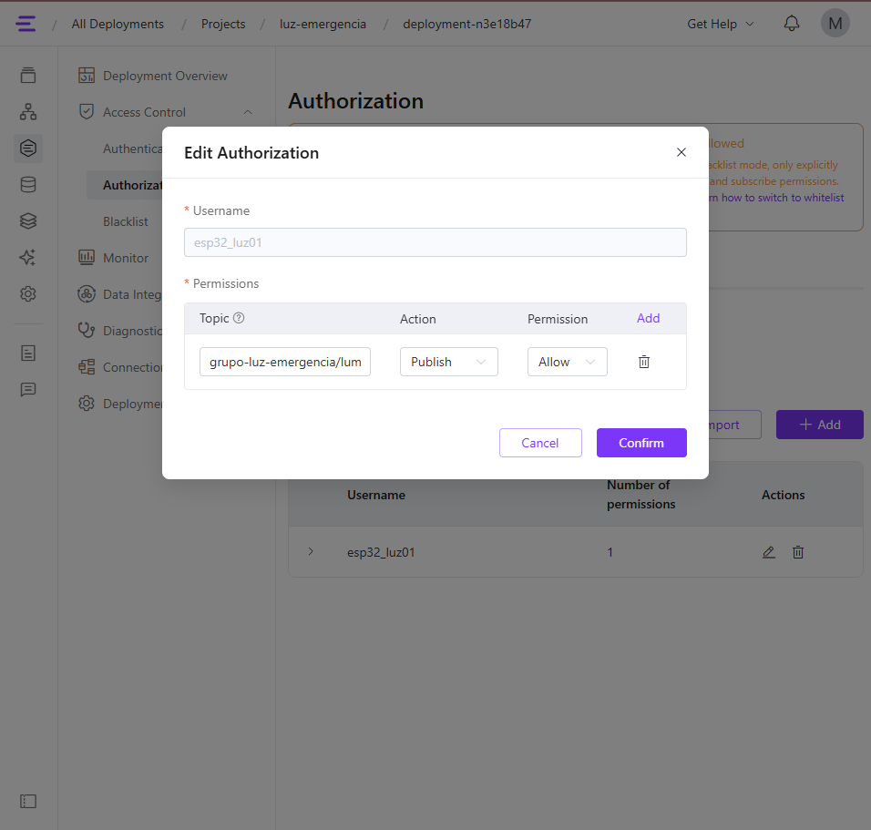
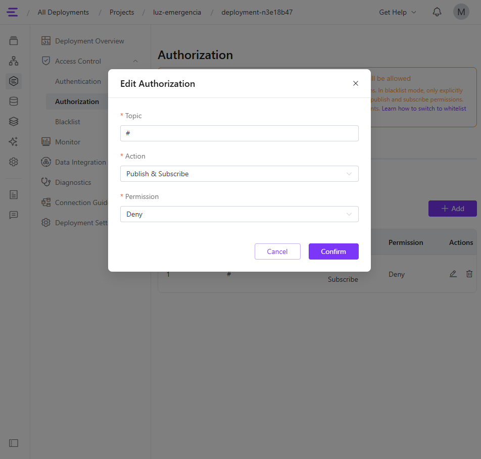
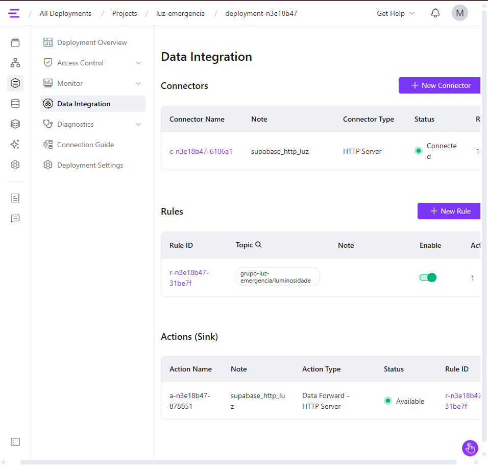
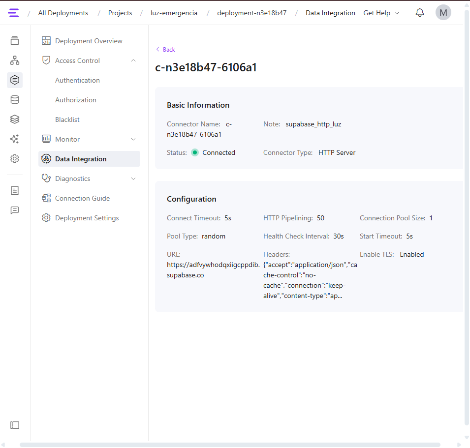
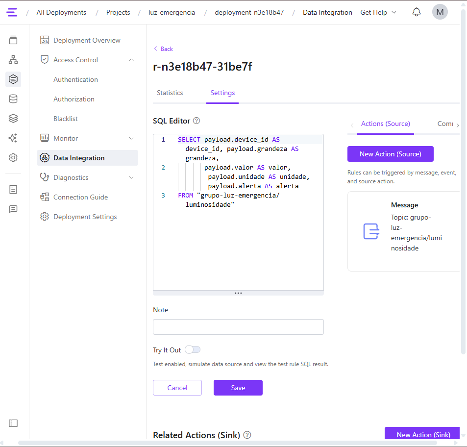

# Broker MQTT no EMQX (Etapa 3)

O EMQX recebe as leituras publicadas pelo ESP32 (Wokwi) por MQTT sobre TLS e as encaminha, por um conector HTTP, para a função `ingest` do Supabase.

```
ESP32 (Wokwi) --MQTT/TLS 8883--> EMQX --HTTPS POST--> função ingest --> tabela leituras
```

Baseado no roteiro da Aula 13, adaptado ao nosso projeto. **Nenhuma senha ou chave fica neste arquivo.**

## Nomes usados
| Item | Valor |
|---|---|
| Projeto / deployment EMQX | `luz-emergencia` / `deployment-n3e18b47` (Serverless) |
| Usuário MQTT | `esp32_luz01` |
| Tópico MQTT | `grupo-luz-emergencia/luminosidade` |
| Conector HTTP | `c-n3e18b47-6106a1` (nota: `supabase_http_luz`) |
| Regra | `r-n3e18b47-31be7f` |
| Ação | `a-n3e18b47-878851` (nota: `supabase_http_luz`) |
| Função Supabase | `https://adfvywhodqxiigcppdib.supabase.co/functions/v1/ingest` |

## 1. Broker
1. Deployment **Serverless**, *Spend Limit* = 0.
2. Em *Deployment Overview*, anotar o **Address** (`xxxx.emqxsl.com`) e a porta **8883** (MQTT sobre TLS).
3. Na linha *CA Certificate*, baixar a CA do broker. Ela é colada em `ca_cert.py` dentro do Wokwi.

## 2. Usuário e permissões
- *Access Control > Authentication > Add*: usuário `esp32_luz01` e a senha MQTT (guardada fora do GitHub). Superuser desativado.
- *Access Control > Authorization*:

| Aba | Usuário / tópico | Ação / permissão |
|---|---|---|
| Username | `esp32_luz01` → `grupo-luz-emergencia/luminosidade` | Publish / **Allow** |
| All Users | `#` | Publish & Subscribe / **Deny** |

## 3. Conector HTTP (*Data Integration > New Connector > HTTP Server*)
| Campo | Valor |
|---|---|
| Connector Name | `supabase_http_luz` |
| URL | `https://adfvywhodqxiigcppdib.supabase.co` (**sem** caminho) |
| Enable TLS / TLS Verify | ligados |
| CA Cert | `docs/certificados/supabase-gts-root-r4.pem` (**um só** certificado) |
| SNI | `adfvywhodqxiigcppdib.supabase.co` (sem `https://`) |
| TLS Cert / TLS Key | vazios |

Clique em *Test Connectivity* e depois em criar o conector.

## 4. Regra
```sql
SELECT payload.device_id AS device_id, payload.grandeza AS grandeza,
       payload.valor AS valor, payload.unidade AS unidade, payload.alerta AS alerta
FROM "grupo-luz-emergencia/luminosidade"
```

*Try It Out*: Data Source `Message Publish`, Client ID `teste_luz`, Username `esp32_luz01`, **Topic `grupo-luz-emergencia/luminosidade`** (trocar o `t/a`), QoS 0, Payload:

```json
{"device_id":"esp32-luz-01","grandeza":"luminosidade","valor":55,"unidade":"%","alerta":false}
```

A saída deve ser o mesmo JSON, sem aninhamento.

## 5. Ação
| Campo | Valor |
|---|---|
| Connector | `supabase_http_luz` |
| Action Name | `post_ingest_luz` |
| Method | `POST` |
| URL Path | `/functions/v1/ingest` |
| Header `Content-Type` | `application/json` |
| Header `x-api-key` | valor de `INGEST_KEY` (secreto) |
| Body | `${.}` |

Salve a regra **habilitada**.

## 6. Teste
No *Diagnostics > WebSocket Client*, conectar e publicar no tópico acima o JSON de teste. A linha deve aparecer em `GET /functions/v1/api`.

## Limitações
- O WebSocket Client do EMQX usa outro usuário, então a regra *Deny* pode bloquear o teste por ele. Se isso acontecer, teste pelo Wokwi.
- A cadeia de certificados do Supabase pode mudar. Se houver erro TLS, confira a CA do conector.

## Prints da configuração

Prints do console do EMQX da implantação em uso. Senhas e o valor do header `x-api-key` não aparecem.

### 1. Implantação
Serverless em execução, com o endereço e a porta MQTT/TLS 8883.



### 2. Usuário MQTT
Usuário `esp32_luz01` em *Access Control > Authentication*.



### 3. Permissão do usuário
O usuário só pode publicar (**Allow**) no tópico `grupo-luz-emergencia/luminosidade`.



### 4. Permissão geral
Regra para todos os usuários: tópico `#`, Publish & Subscribe, **Deny**.



### 5. Data Integration
O conector HTTP conectado, a regra habilitada e a ação de envio disponível.



### 6. Conector HTTP
Conector para a URL base do Supabase, com TLS habilitado.



### 7. Regra
SQL que extrai os campos da mensagem publicada no tópico do grupo.



